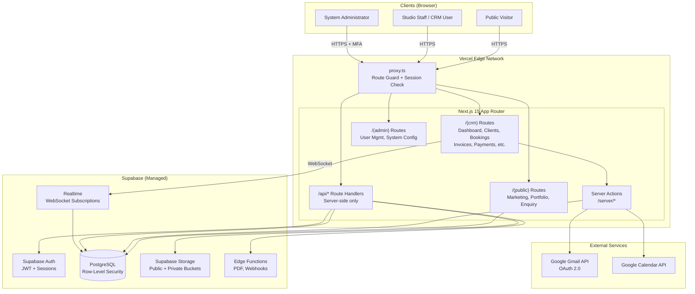
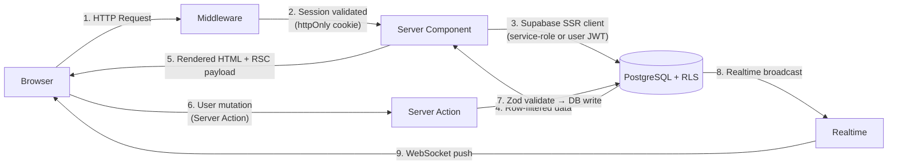
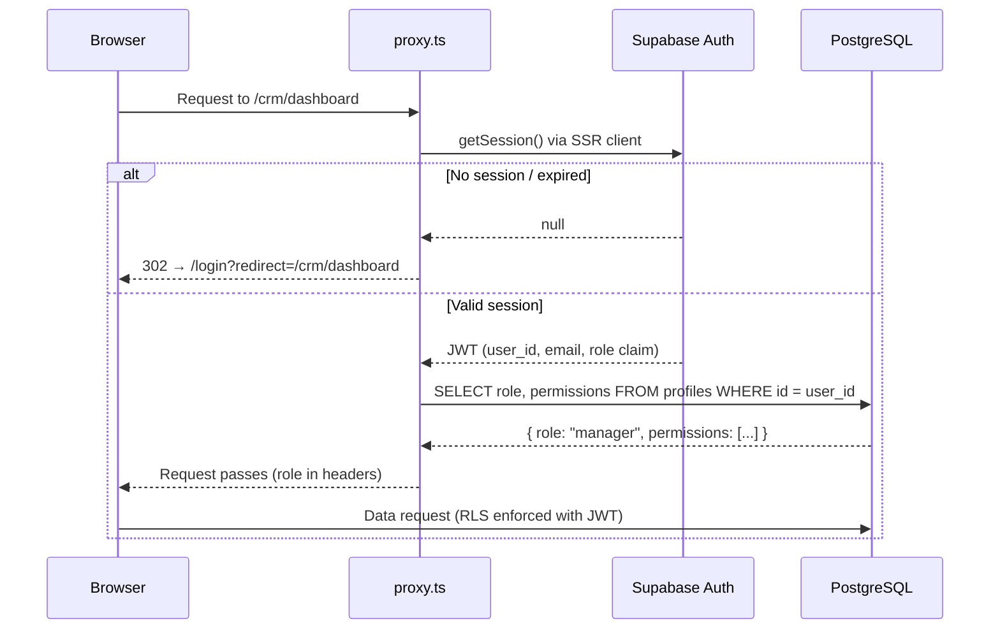
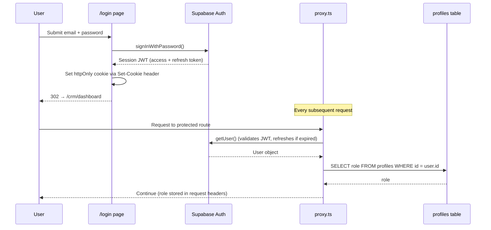

# VOWS Studio — System Architecture
> **Reconciled 2026-11-10.** Where this document disagrees with DECISION_LOG.md or GLOSSARY_AND_ENUMS.md, those files win.


> **Version:** 1.0.0 | **Last Updated:** November 2026 | **Status:** Draft

---

## Table of Contents

1. [Architectural Overview](#1-architectural-overview)
2. [Next.js App Router Structure](#2-nextjs-app-router-structure)
3. [Authentication Architecture](#3-authentication-architecture)
4. [Authorization Architecture](#4-authorization-architecture)
5. [Data Fetching Strategy](#5-data-fetching-strategy)
6. [PDF Generation Strategy](#6-pdf-generation-strategy)
7. [Email Strategy](#7-email-strategy)
8. [File Storage Strategy](#8-file-storage-strategy)
9. [State Management](#9-state-management)
10. [Component Architecture](#10-component-architecture)
11. [Settings Architecture](#11-settings-architecture)
12. [Deployment Architecture](#12-deployment-architecture)
13. [Performance Considerations](#13-performance-considerations)

---

## 1. Architectural Overview

VOWS Studio is a full-stack photography and videography business management platform built for a Karnataka-based studio. It is split into three distinct surface areas: a **public-facing marketing website**, an internal **CRM application** for business operations, and a **system administration panel** for platform management.

### 1.1 High-Level System Diagram



### 1.2 Three-Tier Separation

| Tier | Route Prefix | Access | Purpose |
|------|-------------|--------|---------|
| **Public Website** | `/` | Anyone | Portfolio, services, enquiry forms, reviews |
| **CRM Application** | `/crm/*` | Authenticated + Role | Day-to-day business operations |
| **System Administration** | `/admin/*` | `system_admin` role + MFA | Platform config, user provisioning |

### 1.3 Data Flow



### 1.4 Authentication & Authorization Flow



---

## 2. Next.js App Router Structure

### 2.1 Complete Folder Tree

```
/
├── app/
│   ├── layout.tsx                        # Root layout (fonts, providers)
│   ├── globals.css                       # Tailwind v4 base styles + design tokens
│   │
│   ├── (public)/                         # Public website group (no auth required)
│   │   ├── layout.tsx                    # Public layout (navbar, footer)
│   │   ├── page.tsx                      # Home / landing page
│   │   ├── portfolio/
│   │   │   ├── page.tsx                  # Portfolio gallery
│   │   │   └── [category]/page.tsx       # Category-filtered portfolio
│   │   ├── services/
│   │   │   └── page.tsx                  # Services & packages listing
│   │   ├── about/page.tsx
│   │   ├── contact/page.tsx
│   │   ├── reviews/page.tsx              # Public testimonials
│   │   └── enquiry/
│   │       ├── page.tsx                  # Enquiry intake form
│   │       └── success/page.tsx
│   │
│   ├── (auth)/                           # Auth pages (login, reset, invite)
│   │   ├── layout.tsx
│   │   ├── login/page.tsx
│   │   ├── logout/page.tsx
│   │   ├── forgot-password/page.tsx
│   │   ├── reset-password/page.tsx
│   │   ├── invite/[token]/page.tsx       # Staff invitation acceptance
│   │   └── mfa/page.tsx                 # MFA challenge (admin only)
│   │
│   ├── (crm)/                            # Protected CRM — role-gated
│   │   ├── layout.tsx                    # CRM shell (sidebar, topbar)
│   │   ├── crm/
│   │   │   ├── dashboard/page.tsx
│   │   │   ├── clients/
│   │   │   │   ├── page.tsx             # Client list
│   │   │   │   ├── new/page.tsx
│   │   │   │   └── [id]/
│   │   │   │       ├── page.tsx         # Client detail
│   │   │   │       ├── bookings/page.tsx
│   │   │   │       ├── invoices/page.tsx
│   │   │   │       └── notes/page.tsx
│   │   │   ├── enquiries/
│   │   │   │   ├── page.tsx
│   │   │   │   └── [id]/page.tsx
│   │   │   ├── quotations/
│   │   │   │   ├── page.tsx
│   │   │   │   ├── new/page.tsx
│   │   │   │   └── [id]/
│   │   │   │       ├── page.tsx
│   │   │   │       └── versions/page.tsx
│   │   │   ├── bookings/
│   │   │   │   ├── page.tsx
│   │   │   │   └── [id]/
│   │   │   │       ├── page.tsx
│   │   │   │       └── events/page.tsx
│   │   │   ├── events/
│   │   │   │   ├── page.tsx             # Calendar view
│   │   │   │   └── [id]/page.tsx
│   │   │   ├── invoices/
│   │   │   │   ├── page.tsx
│   │   │   │   └── [id]/page.tsx
│   │   │   ├── payments/
│   │   │   │   ├── page.tsx
│   │   │   │   └── [id]/page.tsx
│   │   │   ├── ledger/page.tsx
│   │   │   ├── expenses/
│   │   │   │   ├── page.tsx
│   │   │   │   └── [id]/page.tsx
│   │   │   ├── crew/
│   │   │   │   ├── page.tsx
│   │   │   │   └── [id]/page.tsx
│   │   │   ├── services/page.tsx
│   │   │   ├── packages/page.tsx
│   │   │   ├── delivery/
│   │   │   │   ├── page.tsx
│   │   │   │   └── [id]/page.tsx
│   │   │   ├── reviews/page.tsx
│   │   │   └── settings/
│   │   │       ├── page.tsx
│   │   │       ├── studio/page.tsx
│   │   │       ├── branding/page.tsx
│   │   │       ├── gmail/page.tsx       # Gmail OAuth connect
│   │   │       └── team/page.tsx
│   │
│   ├── (admin)/                          # System Admin only — MFA required
│   │   ├── layout.tsx
│   │   └── admin/
│   │       ├── dashboard/page.tsx
│   │       ├── users/
│   │       │   ├── page.tsx
│   │       │   └── [id]/page.tsx
│   │       ├── tenants/page.tsx          # For future multi-tenant support
│   │       ├── audit-log/page.tsx
│   │       └── system/page.tsx
│   │
│   └── api/                              # API Route Handlers (server-only)
│       ├── auth/
│       │   ├── callback/route.ts         # Supabase OAuth callback
│       │   └── invite/route.ts
│       ├── clients/route.ts
│       ├── clients/[id]/route.ts
│       ├── enquiries/route.ts
│       ├── quotations/
│       │   ├── route.ts
│       │   └── [id]/
│       │       ├── route.ts
│       │       ├── pdf/route.ts          # PDF generation endpoint
│       │       └── send/route.ts         # Gmail send endpoint
│       ├── bookings/route.ts
│       ├── bookings/[id]/route.ts
│       ├── events/route.ts
│       ├── invoices/route.ts
│       ├── invoices/[id]/route.ts
│       ├── payments/route.ts
│       ├── ledger/route.ts
│       ├── expenses/route.ts
│       ├── crew/route.ts
│       ├── services/route.ts
│       ├── packages/route.ts
│       ├── delivery/route.ts
│       ├── reviews/route.ts
│       ├── settings/route.ts
│       ├── uploads/route.ts
│       └── public/
│           ├── portfolio/route.ts        # Public portfolio (no auth)
│           ├── services/route.ts
│           └── reviews/route.ts
│
├── components/
│   ├── ui/                               # Base design system (shadcn/ui + custom)
│   │   ├── button.tsx
│   │   ├── input.tsx
│   │   ├── dialog.tsx
│   │   ├── table.tsx
│   │   ├── badge.tsx
│   │   ├── card.tsx
│   │   ├── dropdown-menu.tsx
│   │   ├── form.tsx                      # React Hook Form wrappers
│   │   ├── date-picker.tsx
│   │   └── data-table/                  # Tanstack Table integration
│   │       ├── data-table.tsx
│   │       ├── data-table-toolbar.tsx
│   │       └── data-table-pagination.tsx
│   ├── crm/                              # CRM-specific composed components
│   │   ├── sidebar.tsx
│   │   ├── topbar.tsx
│   │   ├── client-card.tsx
│   │   ├── booking-timeline.tsx
│   │   ├── invoice-preview.tsx
│   │   ├── payment-form.tsx
│   │   ├── quotation-builder.tsx
│   │   ├── event-calendar.tsx
│   │   ├── delivery-tracker.tsx
│   │   └── dashboard/
│   │       ├── stats-widget.tsx
│   │       ├── upcoming-events.tsx
│   │       └── revenue-chart.tsx
│   ├── public/                           # Public site components
│   │   ├── hero.tsx
│   │   ├── portfolio-grid.tsx
│   │   ├── service-card.tsx
│   │   ├── enquiry-form.tsx
│   │   ├── testimonial-carousel.tsx
│   │   └── navbar.tsx
│   ├── admin/                            # Admin panel components
│   │   ├── user-management-table.tsx
│   │   ├── audit-log-viewer.tsx
│   │   └── system-status.tsx
│   └── shared/                           # Cross-boundary (PDF viewer, file uploader, etc.)
│       ├── pdf-viewer.tsx
│       ├── file-uploader.tsx
│       ├── rich-text-editor.tsx
│       ├── confirm-dialog.tsx
│       └── error-boundary.tsx
│
├── lib/
│   ├── supabase/
│   │   ├── client.ts                     # Browser client (anon key)
│   │   ├── server.ts                     # Server-side client (cookies)
│   │   ├── admin.ts                      # Service-role admin client
│   │   └── proxy.ts                 # Session refresh helper
│   ├── validations/                      # Zod schemas per domain
│   │   ├── client.schema.ts
│   │   ├── enquiry.schema.ts
│   │   ├── quotation.schema.ts
│   │   ├── booking.schema.ts
│   │   ├── invoice.schema.ts
│   │   ├── payment.schema.ts
│   │   ├── expense.schema.ts
│   │   ├── crew.schema.ts
│   │   └── settings.schema.ts
│   ├── utils/
│   │   ├── currency.ts                   # INR formatting helpers
│   │   ├── date.ts                       # Date formatting (IST timezone)
│   │   ├── pdf.ts                        # PDF generation utilities
│   │   └── slugify.ts
│   └── constants/
│       ├── roles.ts                      # Role enum + hierarchy
│       ├── routes.ts                     # Route constants + helpers
│       └── permissions.ts               # Permission map per role
│
├── types/
│   ├── database.types.ts                 # Auto-generated Supabase types
│   ├── api.types.ts                      # API request/response shapes
│   ├── auth.types.ts
│   └── domain/
│       ├── client.ts
│       ├── booking.ts
│       ├── invoice.ts
│       └── ...
│
├── hooks/
│   ├── use-session.ts                    # Current user + role
│   ├── use-permissions.ts               # Permission checking hook
│   ├── use-realtime.ts                  # Supabase Realtime subscription
│   ├── use-settings.ts                  # Studio settings context hook
│   └── use-debounce.ts
│
├── server/
│   ├── actions/                          # Server Actions (mutations)
│   │   ├── clients.actions.ts
│   │   ├── enquiries.actions.ts
│   │   ├── quotations.actions.ts
│   │   ├── bookings.actions.ts
│   │   ├── invoices.actions.ts
│   │   ├── payments.actions.ts
│   │   ├── expenses.actions.ts
│   │   └── settings.actions.ts
│   └── queries/                          # Shared server-side query functions
│       ├── clients.queries.ts
│       ├── bookings.queries.ts
│       └── dashboard.queries.ts
│
├── proxy.ts                         # Route protection + role enforcement
└── next.config.ts
```

---

## 3. Authentication Architecture

### 3.1 Supabase Auth Flow

VOWS Studio uses **Supabase Auth** with email/password as the primary authentication method. All session tokens are stored in **httpOnly cookies** (never `localStorage`) to prevent XSS token theft. The Supabase SSR package (`@supabase/ssr`) manages cookie-based session hydration on the server.



### 3.2 Middleware-Based Route Protection

[`proxy.ts`](file:///home/rovik/Documents/Projects/VOWS%20Studio/proxy.ts) intercepts every request before it reaches any page or API route:

- **Public routes** (`/`, `/portfolio`, `/services`, `/reviews`, `/enquiry`) — allowed without session.
- **CRM routes** (`/crm/*`) — require a valid session. Redirect to `/login` if none.
- **Admin routes** (`/admin/*`) — require `system_admin` role AND completed MFA challenge.
- **Auth routes** (`/login`, `/signup`) — if already authenticated, redirect to `/crm/dashboard`.

### 3.3 Session Handling

- Sessions use **access tokens** (1 hour TTL) + **refresh tokens** (rolling, 7-day).
- `@supabase/ssr` `createServerClient()` reads/writes cookies inside middleware and Server Components.
- The middleware calls `supabase.auth.getUser()` on every request (not `getSession()`) to cryptographically validate the JWT, not just decode it.
- Refresh is handled transparently — if the access token is expired and the refresh token is valid, a new pair is issued automatically.

### 3.4 MFA Enforcement for System Admin

- System Admin and Business Owner are forced through MFA enrolment at first login (D-02).
- Middleware checks for `aal2` (Assurance Level 2) claim in the JWT for `/admin/*` routes.
- If only `aal1`, redirect to `/mfa` challenge page before proceeding.
- MFA setup is enforced server-side; it cannot be bypassed.

### 3.5 Role Loading from Database

Roles are **not trusted from the JWT claims** alone. On each protected request, middleware queries `profiles.role` from the database using the **service-role Supabase client** (bypasses RLS). This prevents role escalation via tampered tokens.

---

## 4. Authorization Architecture

### 4.1 Role Hierarchy

The 6 canonical roles are: `system_admin`, `business_owner`, `manager`, `accountant`, `staff`, `crew_member` (GLOSSARY §2).


```
system_admin  (full platform access, user management, audit log)
    └── manager  (full CRM access, all modules, financial reports)
            └── editor   (CRM read + limited write: clients, bookings, delivery)
                    └── viewer   (CRM read-only)
```

Roles are defined in [`/lib/constants/roles.ts`](file:///home/rovik/Documents/Projects/VOWS%20Studio/lib/constants/roles.ts).

### 4.2 Server-Side Permission Checks

Every Server Action and API route handler performs an explicit permission check **before** executing any logic:

```typescript
// Example: server/actions/invoices.actions.ts
export async function createInvoice(data: unknown) {
  const { user, role } = await getAuthenticatedUser(); // throws if not authed
  requirePermission(role, 'invoices:create');           // throws 403 if denied
  const validated = InvoiceCreateSchema.parse(data);    // Zod validation
  // ... proceed with DB write
}
```

### 4.3 Row-Level Security (RLS) as Final Safety Layer

Supabase RLS policies on every table enforce data isolation as a **defense-in-depth** layer. Even if application-level permission checks were bypassed, the database user (authenticated via JWT) cannot access rows they are not permitted to see.

Example RLS policy:
```sql
-- Only active staff can read client records
CREATE POLICY "staff_read_clients" ON clients
  FOR SELECT
  USING (
    auth.uid() IN (
      SELECT id FROM profiles WHERE role IN ('manager', 'editor', 'viewer', 'system_admin')
    )
  );
```

### 4.4 Client-Side Role Usage

The session hook (`useSession`) exposes the role for **UI rendering purposes only** (show/hide buttons, menu items). It is **never used to gate actual data access**. All authorization decisions happen server-side.

---

## 5. Data Fetching Strategy

### 5.1 Server Components (Primary)

All initial data loads use **React Server Components** with Supabase's SSR server client. This avoids prop drilling, eliminates loading spinners for initial renders, and keeps sensitive DB queries server-side.

```typescript
// app/(crm)/crm/clients/page.tsx — Server Component
export default async function ClientsPage() {
  const supabase = createServerClient();
  const { data: clients } = await supabase.from('clients').select('*').order('created_at', { ascending: false });
  return <ClientsTable initialData={clients} />;
}
```

### 5.2 Client Components (Interactivity)

Client components are used for:
- Forms (React Hook Form)
- Real-time updated widgets
- Modals, dropdowns, interactive tables
- Optimistic UI updates

### 5.3 Supabase Realtime

The dashboard and event calendar subscribe to Supabase Realtime for live updates (new enquiries, payment notifications). Subscriptions are managed via the custom `useRealtime` hook.

### 5.4 Client-Side Caching — TanStack Query (React Query)

**TanStack Query** (React Query v5) is chosen over SWR for:
- Superior devtools and cache inspection
- Fine-grained `invalidateQueries` after Server Action mutations
- Better TypeScript inference
- Support for `suspense` mode compatible with React 19

Mutations triggered via Server Actions call `queryClient.invalidateQueries()` to refresh stale data.

### 5.5 Server Actions for Mutations

All write operations go through typed Server Actions with Zod validation. They are **never** exposed as bare API routes unless an external integration requires it.

---

## 6. PDF Generation Strategy

### 6.1 Chosen Approach: `@react-pdf/renderer` on Vercel Functions

**`@react-pdf/renderer`** is chosen over Puppeteer because:
- Runs in Node.js without a headless browser (Puppeteer is too large for Vercel serverless limits)
- Declarative React components for templates — consistent with the existing stack
- No cold-start penalty from launching Chrome

PDF generation is triggered via `/api/quotations/[id]/pdf` and `/api/invoices/[id]/pdf`.

### 6.2 Storage and Access

1. PDF is generated server-side and streamed to **Supabase Storage** (`documents/` bucket).
2. A signed URL (1-hour TTL) is returned to the client.
3. Client uses the signed URL to display in `<PDFViewer>` or trigger a download.
4. For Gmail sending, the PDF buffer is attached directly without storing (unless a record is needed).

---

## 7. Email Strategy

### 7.1 Gmail OAuth Integration

- Studio connects their Gmail account via Google OAuth 2.0 (from `/crm/settings/gmail`).
- OAuth tokens (access + refresh) are stored **encrypted in the database** (`gmail_credentials` table), never in environment variables or client state.
- All Gmail API calls are made **server-side only** via Server Actions or API routes.

### 7.2 Email Templates

**React Email (Layout and styling are React Email components; subject and body content are owner-editable database templates with whitelisted merge tags, D-27)** (`@react-email/components`) is used for all transactional email templates (quotations, invoices, booking confirmations). Templates are rendered to HTML strings on the server before sending via Gmail API.

### 7.3 Fallback Strategy

If Gmail is not connected or token is expired:
1. User is prompted to reconnect Gmail.
2. PDF download is offered as an alternative.
3. A system notification is logged.

---

## 8. File Storage Strategy

### 8.1 Supabase Storage Buckets

Buckets per GLOSSARY §10: `portfolio` (public, 20MB), `branding` (public, 5MB), `documents` (private, 10MB), `client-uploads` (private, 50MB), `expense-receipts` (private, 10MB), `crew-assets` (private, 10MB).


| Bucket | Access | Contents | RLS |
|--------|--------|----------|-----|
| `portfolio` | **Public** | Portfolio images, videos displayed on website | Public read, authenticated write |
| `client-documents` | **Private** | Contracts, delivery media, signed forms | Authenticated only, owner-scoped |
| `pdfs` | **Private** | Generated quotation / invoice PDFs | Authenticated only, role-scoped |
| `crew-assets` | **Private** | Crew ID proofs, agreements | Manager+ only |
| `branding` | **Public** (CDN) | Studio logo, watermarks used in PDFs | Public read, admin write |

### 8.2 Access Control

- Private buckets require **signed URLs** (short TTL) generated server-side.
- Public bucket objects are served via Supabase CDN — cached at edge.
- Storage RLS policies mirror table-level policies; e.g., only the booking's linked staff can read its delivery media.

---

## 9. State Management

| Concern | Tool | Rationale |
|---------|------|-----------|
| Server data (lists, records) | **TanStack Query** | Cache, dedup, background refresh |
| Form state | **React Hook Form + Zod** | Performant uncontrolled forms with schema validation |
| UI state (modals, sidebar) | **Local `useState`** | Localized, no global leakage |
| Auth session + role | **React Context** (`SessionProvider`) | Read-only, set once after login |
| Studio settings | **React Context** (`SettingsProvider`) | Loaded server-side, hydrated into context |
| Complex client interactions | **Zustand** (selective) | Quotation builder line-item editor — complex multi-step form |

> [!IMPORTANT]
> Global state is intentionally minimized. TanStack Query serves as the primary "state manager" for server data. Zustand is only introduced when truly needed (e.g., multi-step quotation builder with shared ephemeral state across components).

---

## 10. Component Architecture

### 10.1 Feature-Based + Atomic Hybrid

A **feature-based** structure is used for `components/crm/`, `components/public/`, and `components/admin/`. Atomic base components (`components/ui/`) follow atomic design principles. This balances discoverability with colocation.

### 10.2 UI Library: shadcn/ui

**shadcn/ui** is chosen because:
- Components are copy-owned (no runtime dependency)
- Full Tailwind CSS v4 compatibility
- Accessible (Radix UI primitives)
- Customizable without fighting a library's internal styles

### 10.3 Design Tokens

Tailwind CSS v4 `@theme` block defines CSS custom properties for brand colours, typography, and spacing. Studio branding (primary colour, logo) loaded from Settings are injected as CSS variables at runtime via the `SettingsProvider`.

### 10.4 Theming

Light/dark mode is supported via Tailwind's `dark:` variant. The user's OS preference is respected by default; a manual toggle is available in the CRM topbar.

---

## 11. Settings Architecture

### 11.1 Database-Driven Configuration

All studio settings (name, address, logo URL, GST number, bank details, payment terms, branding colours) are stored in a `settings` table in PostgreSQL. There is a single row per studio .

### 11.2 Settings Caching

Settings are fetched **once per request** in the root CRM layout's Server Component and passed to `<SettingsProvider>` as an initial value. The provider caches them in React Context — no redundant fetches per page.

After a settings update (via Server Action), `revalidatePath('/crm')` is called to bust the Next.js route cache, ensuring the next request reflects updated settings.

### 11.3 Immutable Settings

The following settings are **not user-editable** after initial setup and require System Admin access to change:

- Studio's Supabase project reference
- Auth provider configuration
- Gmail OAuth client credentials (`.env` only)
- Supabase service-role key

---

## 12. Deployment Architecture

### 12.1 Vercel Project Structure

- **Single Vercel project** for the Next.js application
- **Supabase** hosted on Supabase cloud (managed PostgreSQL, Auth, Storage)
- Static assets served from Vercel Edge CDN

### 12.2 Environment Variables

Canonical environment variables are defined in GLOSSARY §9.
 Strategy

| Variable | Environment | Description |
|----------|-------------|-------------|
| `NEXT_PUBLIC_SUPABASE_URL` | All | Supabase project URL |
| `NEXT_PUBLIC_SUPABASE_ANON_KEY` | All | Public anon key |
| `SUPABASE_SERVICE_ROLE_KEY` | Server only | Never exposed to client |
| `GOOGLE_CLIENT_ID` | Server only | Gmail OAuth |
| `GOOGLE_CLIENT_SECRET` | Server only | Gmail OAuth |
| `GOOGLE_TOKEN_ENCRYPTION_KEY` | Server only | For encrypting stored OAuth tokens |
| `NEXT_PUBLIC_APP_URL` | All | Canonical URL for redirects |

Environment variables are set in Vercel's dashboard; **never committed to Git**.

### 12.3 Deployment Environments

| Environment | Branch | Purpose |
|-------------|--------|---------|
| **Production** | `main` | Live studio instance |
| **Preview** | PR branches | Staging/review per pull request |
| **Development** | Local | Developer machines with `.env.local` |

### 12.4 Demo Deployment

A read-only demo instance can be deployed as a separate Vercel project pointing to a **seeded Supabase project** with synthetic data. Environment variable `NEXT_PUBLIC_APP_MODE=true` enables demo banners and disables writes.

---

## 13. Performance Considerations

### 13.1 ISR for Public Pages

Public pages (portfolio, services, reviews) use **Incremental Static Regeneration** with a `revalidate` interval (e.g., 300 seconds). This serves cached HTML from the CDN while keeping content fresh.

```typescript
// app/(public)/portfolio/page.tsx
export const revalidate = 300; // ISR — revalidate every 5 minutes
```

### 13.2 Image Optimization

- **Next.js `<Image>`** component is used for all images (automatic WebP conversion, lazy loading, responsive sizes).
- Portfolio images stored in Supabase Storage are served through Supabase CDN; their URLs are passed to `<Image>` with `remotePatterns` configured.

### 13.3 Code Splitting

- Route-level code splitting is automatic in App Router.
- Heavy components (PDF viewer, rich text editor, chart library) are lazy-loaded with `dynamic(() => import(...), { ssr: false })`.
- Barrel exports (`index.ts`) are avoided to prevent bundler from pulling unused code.

---

*Document maintained by the engineering team. Update when architectural decisions change.*
