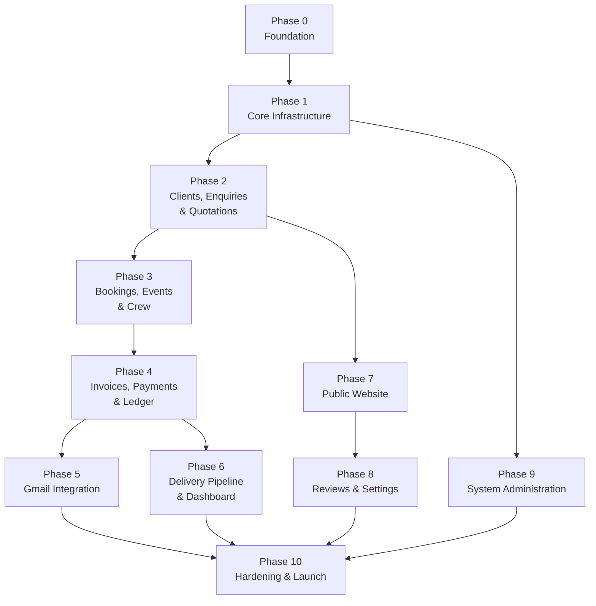

# VOWS Studio — Implementation Roadmap
> **Reconciled 2026-11-10.** Where this document disagrees with DECISION_LOG.md or GLOSSARY_AND_ENUMS.md, those files win.


> **Stack:** Next.js 16 App Router · React 19 · TypeScript · Tailwind CSS v4 · Supabase · Zod · Vercel · GitHub
> **Team:** One developer (Technical Admin / Developer)
> **Business Context:** Real photography & videography studio, Karnataka, India — financial accuracy is non-negotiable.

---

## 1. Phasing Philosophy

### Why we phase this way

Software built for a live business carries immediate financial and reputational risk. A broken quotation or a misallocated payment affects real clients and real money. The phasing strategy follows three principles:

1. **Critical path first.** Each phase delivers something the next phase depends on. Auth before CRM, CRM before Invoices, Invoices before Reports. No phase is decorative.
2. **MVP-first.** The public website and advanced analytics are valuable — but the studio already operates. The CRM must work correctly *before* the website launches.
3. **No broken windows.** A feature ships only when it is complete, tested, and handles its error states. Partial features that crash in production are worse than features that don't exist yet.

### What "MVP" means for VOWS Studio specifically

The MVP is the minimum system that lets VOWS Studio run its business entirely through the CRM without reverting to spreadsheets or paper. That means:

| Capability | Why it must work on Day 1 |
|---|---|
| Staff and admin login with MFA | Studio handles client financial data |
| Client creation and management | Every other entity links to a client |
| Enquiry → Quotation → PDF | Primary sales workflow |
| Quotation → Booking → Crew assignment | Operational scheduling |
| Invoice → Payment → Receipt | Money in, money recorded |
| Outstanding balance view | Business viability check |
| Audit log | Accountability for every mutation |

The public website, delivery pipeline, dashboard charts, Gmail integration, and reviews are **not** MVP. They improve the business but do not block operation.

### How to identify when a phase is truly done

A phase is done when:

- All database migrations are applied to both dev and production Supabase
- All UI flows in the deliverable work end-to-end without console errors
- RLS policies have been manually verified for every new table
- Unit tests pass for all new financial/utility functions
- No hardcoded test data remains in production code
- The deliverable has been demonstrated against real or realistic data
- Definition of Done checklist (§15) for that phase is signed off

---

## 2. Phase 0: Foundation (Pre-coding)

> No code is written until this phase is complete. Skipping it creates expensive rework.

### Checklist

- [ ] **Architecture documentation complete** — `DATABASE_SCHEMA.md`, `API_ROUTES.md`, `RBAC_MATRIX.md`, `SYSTEM_ARCHITECTURE.md`, `IMPLEMENTATION_ROADMAP.md`, `TESTING_PLAN.md` all reviewed and approved
- [ ] **Supabase projects created** — separate `vows-studio-dev` and `vows-studio-prod` projects; connection strings recorded in password manager, not in code
- [ ] **GitHub repository created** — private repo; branch strategy documented (see below); `.gitignore` includes `.env*.local`
- [ ] **Vercel project connected** — linked to GitHub repo; preview deployments enabled; env vars set for dev project
- [ ] **Google Cloud Console project created** — OAuth 2.0 credentials created for Gmail API; authorised redirect URIs set for localhost, Vercel preview, and production domain
- [ ] **Google Stitch / Figma designs approved** — component inventory, colour tokens, typography scale, and all page layouts signed off before a single React component is written
- [ ] **Database schema reviewed and approved** — `DATABASE_SCHEMA.md` has been read by the developer and the business owner has confirmed the data model matches actual business process
- [ ] **Development environment set up** — Node.js LTS, pnpm, Supabase CLI, Playwright, VSCode extensions (ESLint, Prettier, Tailwind IntelliSense, Prisma/SQL tools)

### Branch Strategy

```
main          → production (Vercel production deployment)
dev           → integration branch (Vercel preview deployment pointing to dev Supabase)
feature/*     → individual features, PR'd into dev
hotfix/*      → critical production fixes, PR'd directly into main then merged back to dev
```

**Rules:**
- `main` is protected — no direct pushes
- Every PR requires a passing Vitest run (CI)
- Migrations are applied to dev Supabase first, then manually promoted to production after verification

---

## 3. Phase 1: Core Infrastructure

**Goal:** The skeleton of the system exists. Every role can log in, land on the correct layout, and be blocked from routes they should not access.

### Tasks

#### Project Scaffolding
- `pnpm create next-app` with TypeScript, App Router, Tailwind CSS v4
- Configure `tsconfig.json` strict mode
- Configure `eslint` and `prettier`
- Configure `@/` path alias
- Set up `lib/`, `components/`, `app/`, `types/`, `utils/`, `hooks/`, `actions/` directory structure

#### Supabase Setup
- Install `@supabase/ssr` and `@supabase/supabase-js`
- Create `lib/supabase/server.ts` (Server Component / Server Action client)
- Create `lib/supabase/client.ts` (Client Component client)
- Create `lib/supabase/proxy.ts` (session refresh)
- Configure `proxy.ts` at project root for route protection

#### Authentication
- Supabase Auth with email/password
- MFA (TOTP) enforcement for `system_admin` and `staff` roles
- Login page at `/login`
- MFA challenge page at `/auth/mfa`
- Auth callback route at `/auth/callback`
- Redirect logic: post-login redirect by role

#### Database Migrations (Phase 1 tables)
- `profiles` — extends `auth.users`, holds display name, role, avatar
- `roles` — enum or lookup table: `system_admin`, `staff`, `crew_member`, `client_viewer`
- `audit_log` — `user_id`, `action`, `table_name`, `record_id`, `old_values` (jsonb), `new_values` (jsonb), `ip_address`, `created_at`
- RLS policies for all Phase 1 tables
- Audit trigger function (generic, applied to all tables that need it)

#### Design System
- Install and configure `shadcn/ui` with VOWS Studio colour tokens
- Typography scale (Tailwind CSS v4 theme)
- Icon set (Lucide)
- Base component variants: Button, Input, Label, Card, Badge, Dialog, Sheet, Dropdown

#### Layout Components
- `AppShell` — wraps CRM pages, handles sidebar + topbar
- `Sidebar` — role-aware navigation links, collapsible on mobile
- `Topbar` — user avatar, notifications placeholder, breadcrumb
- `PublicNav` — navigation for public website (Phase 7)

#### System Admin: User Management
- User list page (admin only)
- Invite user (send magic link or set temp password)
- Edit user role
- Deactivate user

### Deliverable

> Can log in as any role (system_admin, staff, crew_member), see the correct layout and navigation for that role, be redirected away from forbidden routes with a proper 403 page, and log out cleanly.

---

## 4. Phase 2: Clients, Enquiries and Quotations

**Goal:** The studio's sales workflow from first contact to signed-off quotation PDF is fully operational.

### Tasks

#### Database Migrations
- `clients` — name, phone, email, address, notes, created_by, created_at
- `enquiries` — client_id, event_type, event_date, venue, status, source, notes, assigned_to, follow_up_at
- `quotations` — enquiry_id, client_id, quotation_number, version, status, valid_until, subtotal, discount_amount, tax_amount, total_amount, notes, terms, created_by, snapshot (jsonb)
- `quotation_items` — quotation_id, description, unit_price (integer paise), quantity, discount_pct, line_total (integer paise)
- `quotation_versions` — full snapshot of quotation + items at each version point
- RLS for all tables (staff can create/edit, crew_member read-only on assigned, client_viewer blocked)

#### Client Module
- Client list (search, filter, sort)
- Client create form (Zod-validated)
- Client detail page (contact info, enquiries list, documents list)
- Client edit
- Client soft-delete

#### Enquiry Module
- Enquiry list (filter by status, assigned_to, date)
- Enquiry create (from client page or standalone)
- Enquiry detail (timeline, status, follow-up)
- Status transitions: `new → contacted → quoted → converted → lost`
- Follow-up scheduling (date + note, appears in dashboard widget)
- Enquiry edit / notes

#### Quotation Builder
- Quotation create from enquiry
- Dynamic line item editor (add/remove/reorder rows)
- Per-item: description, unit price, quantity, discount %
- Auto-calculated: line total, subtotal, overall discount, tax (GST-ready), grand total
- All monetary arithmetic in integer paise; display only converts to rupees
- Quotation number generation: `QT-YYYY-NNNN` (sequential, no gaps, DB-generated)
- Quotation status machine: `draft → sent → accepted → rejected → expired`
- Version snapshot on every status change
- Valid-until date with auto-expiry detection

#### PDF Generation
- Server-side PDF generation (React → HTML → PDF via `@react-pdf/renderer` or Puppeteer)
- PDF stored in Supabase Storage under `quotations/` bucket (private)
- Signed URL endpoint for download (authenticated, expiring)
- PDF includes: VOWS Studio branding, client details, line items, totals, terms

#### Settings (Phase 2 scope)
- Business profile (name, address, GSTIN, logo upload to Storage)
- Quotation template defaults (terms text, validity days, tax rate)

### Deliverable

> Full enquiry → quotation → PDF workflow working end-to-end. Quotation PDF downloads correctly. Version history viewable. Status transitions enforced. All monetary values accurate in integer paise.

---

## 5. Phase 3: Bookings, Events and Crew

**Goal:** Confirmed work is tracked. Crew is scheduled. No double-bookings.

### Tasks

#### Database Migrations
- `bookings` — client_id, quotation_id (nullable), booking_number, status, total_amount, notes, created_by
- `events` — booking_id, event_type, event_date, start_time, end_time, venue, venue_address, notes
- `crew_members` — profile_id (nullable, for users with crew_member role), name, phone, specialisation, rate_per_day, is_active
- `event_crew_assignments` — event_id, crew_member_id, role_in_event, rate_override, confirmed_at, notes
- `crew_unavailability` — crew_member_id, unavailable_from, unavailable_to, reason

#### Booking Module
- Booking creation from accepted quotation (confirmation step showing client/amount)
- Independent booking creation (without quotation)
- Booking number generation: `BK-{FY}-{NNNNNN}`
- Booking detail page (events list, crew list, invoice status, payment status)
- Booking status machine: `confirmed → in_progress → completed → cancelled`

#### Events Module
- Multiple events per booking (wedding day, pre-shoot, reception)
- Event create/edit/delete within booking
- Event details: date, time range, venue, type

#### Crew Module
- Crew member list (active/inactive filter)
- Crew profile create/edit (name, phone, specialisations, day rate)
- Crew availability calendar (read their `crew_unavailability`)
- Mark crew unavailable (block dates)

#### Crew Assignment
- Assign crew to event (with role: lead photographer, second, videographer, etc.)
- Conflict detection: cannot assign crew already assigned to overlapping event
- Conflict detection: cannot assign crew who marked themselves unavailable
- Confirmation state per assignment

#### Calendar View
- Monthly calendar showing all events
- Event popover with booking link, crew list
- Filter by crew member

### Deliverable

> Full quotation → booking → event → crew assignment workflow. Conflict detection prevents double-booking. Calendar shows all upcoming events.

---

## 6. Phase 4: Invoices, Payments and Ledger

**Goal:** The studio gets paid and every rupee is recorded correctly. This phase has zero tolerance for bugs.

### Tasks

#### Database Migrations
- `invoices` — booking_id, client_id, invoice_number, version, status, due_date, subtotal, discount_amount, tax_amount, total_amount (all integer paise), notes, snapshot (jsonb)
- `invoice_items` — invoice_id, description, unit_price, quantity, discount_pct, line_total
- `credit_notes, crew_pay_records, record_payment/void_payment, ledger_entries_v` — full snapshot per version
- `payments` — client_id, payment_date, amount (integer paise), method, reference_number, notes, recorded_by
- `payment_allocations` — payment_id, invoice_id, allocated_amount (integer paise)
- `payment_receipts` — payment_id, receipt_number, pdf_path, generated_at
- `ledger_entries` — entry_date, type (income/expense), category, amount, reference_type, reference_id, description, created_by
- `expenses` — entry_date, category, amount, vendor, description, receipt_path, created_by
- DB constraint: sum of allocations per payment ≤ payment amount
- DB constraint: sum of allocations per invoice ≤ invoice total_amount

#### Invoice Module
- Invoice generation from booking (pre-fills items from quotation)
- Invoice number generation: `INV-YYYY-NNNN`
- Invoice edit (before sending)
- Invoice status machine: `draft → sent → partially_paid → paid → overdue → cancelled`
- Invoice PDF generation (same pipeline as quotations)
- Invoice PDF download (signed URL)
- Overdue detection (cron or on-load check vs due_date)

#### Payment Module
- Record payment (amount, date, method, reference)
- Allocate payment to one or more invoices
- Partial payment support
- Over-allocation prevention (Zod + DB constraint)
- Payment list (filter by client, date range, method)

#### Receipt Generation
- Auto-generate receipt PDF on payment recording
- Receipt number: `RCP-YYYY-NNNN`
- Receipt PDF stored in Storage, downloadable

#### Ledger Module
- Ledger view (chronological, filter by type/category/date)
- Income entries auto-created from payment allocations
- Expense entries from expense module
- Running balance per period

#### Expense Module
- Expense create (category, amount, vendor, date, optional receipt upload)
- Expense list (filter by category, date)

#### Reports (Phase 4 scope)
- Outstanding receivables: invoices with balance > 0
- Overdue invoices (due_date < today, balance > 0)
- Basic P&L (total income vs total expenses for selected period)

### Deliverable

> Invoice generated, PDF downloaded, payment recorded and allocated, receipt generated and downloaded. Outstanding balance accurate. Ledger entries present. All arithmetic done in integer paise with no floating-point errors.

---

## 7. Phase 5: Gmail Integration

**Goal:** Staff can send quotations, invoices, and receipts to clients directly from the CRM without leaving the browser.

### Tasks

- Google OAuth 2.0 flow: initiate, callback, token exchange
- Token storage: `google_tokens` table — `user_id`, `access_token` (encrypted), `refresh_token` (encrypted), `expiry`, `scope`
- Token encryption: AES-256-GCM using `GOOGLE_TOKEN_ENCRYPTION_KEY` env var (server-only)
- Token refresh: automatic on expiry (before API call, check expiry, refresh if needed)
- Gmail send: `POST /api/gmail/send` Server Action — recipient, subject, body (HTML), optional PDF attachment
- Send quotation action: triggered from quotation detail page
- Send invoice action: triggered from invoice detail page
- Send receipt action: triggered from payment/receipt page
- `email_send_log` table: `user_id`, `document_type`, `document_id`, `recipient_email`, `gmail_message_id`, `status`, `sent_at`, `error`
- Error handling: expired token → show reconnect CTA; API error → show error toast and log
- Reconnection flow: user can revoke and re-authorise without data loss
- Settings page: show connected Gmail account, disconnect button

### Deliverable

> System Admin or Business Owner connects their Gmail account, send a quotation PDF to a client's email, and see confirmation of delivery in the send log. Reconnection flow works after token expiry.

---

## 8. Phase 6: Delivery Pipeline and Dashboard

**Goal:** Active jobs have a progress tracker. The business owner sees meaningful KPIs at a glance.

### Tasks

#### Database Migrations
- `deliveries` — booking_id, status, deadline, assigned_editor, notes
- `delivery_stages` — delivery_id, stage_name, order_index, status, due_date, completed_at, notes
- `delivery_feedback` — delivery_id, submitted_by, feedback_text, submitted_at, resolved_at

#### Delivery Pipeline
- Create delivery record from completed event booking
- Predefined stages: 9 stages in GLOSSARY §5 (Ingest, Culling, Color Grading, Teaser, Highlight Film, Raw Selection, Album Design, Client Review, Final Delivery)
- Stage progress tracking (not started / in progress / complete)
- Deadline management per stage
- Feedback thread per delivery

#### Dashboard
- Summary KPIs: revenue this month, bookings this month, outstanding receivables, new enquiries
- Monthly revenue bar chart (last 12 months)
- Booking type breakdown (pie/donut)
- Upcoming events widget (next 7 days)
- Follow-up reminders widget (overdue follow-ups)
- Recent activity feed

### Deliverable

> Dashboard shows real KPIs from actual data. Delivery pipeline tracks at least one completed booking through all stages.

---

## 9. Phase 7: Public Website

**Goal:** A professional public-facing website that showcases VOWS Studio and captures enquiries into the CRM.

### Tasks

- **Static/ISR pages:** Home, About, Services, Packages
- **Portfolio management (CRM):** Upload images to Supabase Storage `portfolio/` bucket, categorise (weddings, pre-shoots, etc.), set published/unpublished, set cover image
- **Portfolio public pages (ISR):** Grid of categories → individual gallery (lightbox)
- **Reviews page:** Approved reviews only (from review moderation module — Phase 8)
- **Enquiry form:** Public form → `POST /api/public/enquiry` → creates `enquiries` row with `source: 'website'`
- **Contact page:** Location map embed, phone, email, social links
- **Supporting pages:** FAQ, Privacy Policy, Terms & Conditions
- **SEO:** `metadata` export per page, `sitemap.xml` route, `robots.txt`
- **Mobile responsiveness:** All pages tested at 375px, 768px, 1280px
- **Performance:** Images via `next/image`, proper `sizes`, lazy loading; target LCP < 3s

### Deliverable

> Public website is live at production domain. Enquiry form creates a record in CRM. Portfolio pages load with published images. All pages are mobile-responsive.

---

## 10. Phase 8: Reviews, Feedback and Settings

**Goal:** Client reviews appear on the website. The studio can configure every document and notification template.

### Tasks

#### Review System
- `reviews` table: `client_id`, `booking_id`, `rating`, `review_text`, `status` (pending/approved/rejected), `response_text`, `submitted_at`
- Public review submission form (via unique link sent to client after delivery)
- Review list in CRM (staff/admin)
- Approve / reject / respond workflow
- Approved reviews displayed on public Reviews page

#### Settings Module (complete)
- Business profile (already started Phase 2 — extend)
- Branding: logo, primary colour
- Document templates: quotation terms, invoice terms, receipt note (rich text editor)
- Email templates: quotation email body, invoice email body, receipt email body
- Notification preferences: which actions trigger which internal notifications

### Deliverable

> Client can submit a review via link, admin moderates it, approved reviews appear on the public site. All settings pages functional and persistent.

---

## 11. Phase 9: System Administration

**Goal:** The system admin has complete visibility and control.

### Tasks

- **Admin Dashboard:** user count, role breakdown, recent audit events
- **Full User Management UI:** list all users, edit role, deactivate, force password reset, view MFA status
- **Audit Log Viewer:** filterable by user, action, table, date range; paginated
- **Backup Configuration:** document how Supabase backups are configured (PITR or daily snapshot); link to restore procedure
- **Security Settings:** session timeout config, MFA enforcement toggle per role
- **System Health:** check Supabase API status, Storage usage, DB table row counts

### Deliverable

> System Admin area fully functional. Audit log viewer shows every mutation with user and timestamp. User management works for all CRUD operations.

---

## 12. Phase 10: Hardening and Launch Preparation

**Goal:** The system is production-ready, secure, performant, and monitored.

### Tasks

#### Security Audit
- [ ] RBAC: every route and server action checks role before executing
- [ ] RLS: every table has row-level security enabled; `enable row security` verified in Supabase dashboard
- [ ] No `service_role` key used client-side
- [ ] XSS: all user-generated content rendered via React (escaped by default); no `dangerouslySetInnerHTML` without sanitisation
- [ ] CSRF: Next.js Server Actions use same-origin enforcement; SameSite=Lax cookies
- [ ] Rate limiting: login endpoint limited (Supabase Auth built-in + optional middleware)
- [ ] Supabase Storage buckets: all private (no public read except explicitly public assets)
- [ ] Environment variables: no secrets in client bundle (`NEXT_PUBLIC_` prefix audit)
- [ ] SQL injection: Supabase client uses parameterised queries; no raw string interpolation in RPC calls

#### Performance
- [ ] Dashboard queries have appropriate DB indexes
- [ ] `loading.tsx` files for all major route segments
- [ ] Suspense boundaries around data-fetching components
- [ ] Images optimised via `next/image`
- [ ] Bundle analysis (`@next/bundle-analyzer`) — no unnecessary client-side imports

#### Quality
- [ ] Error boundaries on all major sections
- [ ] Empty states for every list view
- [ ] 404 and 500 pages styled
- [ ] Accessibility: keyboard navigation, ARIA labels, colour contrast (WCAG AA)
- [ ] Cross-browser: Chrome, Firefox, Safari (desktop); Chrome (Android); Safari (iOS)

#### Production Setup
- [ ] Production Supabase: PITR enabled, connection pooling configured
- [ ] Vercel: production environment variables set, domains configured
- [ ] Custom domain with SSL verified
- [ ] Vercel Analytics enabled
- [ ] Supabase dashboard alerts configured (high error rate, storage threshold)
- [ ] Uptime monitoring (UptimeRobot or Vercel built-in)

### Deliverable

> Security checklist cleared. Performance targets met. System deployed to production domain. Monitoring active.

---

## 13. Post-MVP Enhancements (Future)

These are planned but not in scope for initial launch:

| Enhancement | Notes |
|---|---|
| WhatsApp integration | Business API; needs WABA approval |
| SMS notifications | Twilio or MSG91 for Indian numbers |
| Google Calendar sync | Two-way sync for events |
| Razorpay payment gateway | Online payment links; schema partially ready |
| GST tax support (UI) | Schema columns exist; tax calculation logic needs enabling |
| Advanced financial reports | Aging report, cash flow, category-wise P&L |
| Bulk export (CSV/Excel) | Client list, ledger, payments |
| Client portal | Clients view own quotations, invoices, receipts |
| Portfolio clone / demo deployment | Sales tool for other photographers |

---

## 14. Critical Path Analysis



**Key dependencies:**
- Phase 4 (Financials) is the heaviest dependency — P5, P6, and P10 all wait for it
- Phase 7 (Public Website) can begin after Phase 2 (enquiry form depends on enquiries table)
- Phase 9 (System Admin) can begin after Phase 1 (depends only on users/audit)
- Phase 10 is the terminal gate — nothing launches before it

---

## 15. Definition of Done (Per Phase)

### Phase 0 — Foundation
- [ ] All six architecture documents exist and have been reviewed
- [ ] Dev and prod Supabase projects created, URL and anon key stored securely
- [ ] GitHub repo exists with branch protection on `main`
- [ ] Vercel project connected to GitHub; dev Supabase env vars set in preview environment
- [ ] Google Cloud Console project and OAuth credentials created
- [ ] Designs approved (not "good enough", actually approved)
- [ ] Developer can run `supabase start` locally without errors

### Phase 1 — Core Infrastructure
- [ ] `pnpm dev` runs without TypeScript errors
- [ ] Login page renders and authenticates against Supabase
- [ ] MFA challenge appears and validates correctly
- [ ] Middleware redirects unauthenticated users to `/login`
- [ ] Each role (system_admin, staff, crew_member) sees correct sidebar navigation
- [ ] Accessing a forbidden route returns a 403 page (not a blank screen or crash)
- [ ] Audit log row created on login
- [ ] User invite flow works end-to-end

### Phase 2 — Clients, Enquiries and Quotations
- [ ] Can create a client, create an enquiry for them, and transition it through all statuses
- [ ] Can build a quotation with 5+ line items, discounts, and tax
- [ ] Quotation total matches manual calculation in paise
- [ ] Quotation PDF generates within 5 seconds and downloads correctly
- [ ] Quotation version history shows previous snapshots
- [ ] Quotation numbers are sequential with no duplicates (tested with concurrent inserts)
- [ ] RLS: crew_member cannot create or edit quotations

### Phase 3 — Bookings, Events and Crew
- [ ] Can convert an accepted quotation to a booking
- [ ] Can add multiple events to a booking
- [ ] Can assign crew to an event
- [ ] Conflict detection blocks assigning crew to overlapping events
- [ ] Conflict detection blocks assigning crew who are marked unavailable
- [ ] Calendar view shows all events for the next 30 days
- [ ] Booking number sequential, no duplicates

### Phase 4 — Invoices, Payments and Ledger
- [ ] Invoice generated from booking with correct line items
- [ ] Invoice PDF generates and downloads
- [ ] Payment recorded and allocated to invoice
- [ ] Payment allocation cannot exceed invoice total (blocked at Zod + DB level)
- [ ] Outstanding balance = invoice total − sum of allocations (verified with 3+ test payments)
- [ ] Receipt generated and downloadable
- [ ] Ledger shows income entry for each payment
- [ ] P&L report returns correct figures for a test period
- [ ] All monetary values stored and displayed in integer paise; no floating-point rounding errors observed

### Phase 5 — Gmail Integration
- [ ] Can connect Gmail account via OAuth
- [ ] Can send quotation PDF as email attachment from CRM
- [ ] Email appears in recipient's inbox with correct attachment
- [ ] Send logged in `email_send_log`
- [ ] Token refresh works without user action when token expires
- [ ] Reconnection flow works after revocation

### Phase 6 — Delivery Pipeline and Dashboard
- [ ] Delivery record created from completed booking
- [ ] All stages can be progressed to complete
- [ ] Dashboard KPIs match values calculated directly from DB queries
- [ ] Upcoming events widget shows correct next-7-days events
- [ ] Follow-up reminders widget shows all overdue follow-ups

### Phase 7 — Public Website
- [ ] All static pages render without errors on production
- [ ] Portfolio images load from Supabase Storage
- [ ] Enquiry form submission creates row in `enquiries` table
- [ ] All pages pass Google PageSpeed score ≥ 80 (mobile)
- [ ] `sitemap.xml` and `robots.txt` return correct content
- [ ] No broken links (checked with link checker tool)

### Phase 8 — Reviews and Settings
- [ ] Public review form accessible via unique link
- [ ] Review appears in CRM pending queue
- [ ] Approve → review appears on public Reviews page
- [ ] Reject → review hidden
- [ ] All settings persist across sessions
- [ ] Document templates render in PDF correctly

### Phase 9 — System Administration
- [ ] Audit log viewer shows all mutations from all phases
- [ ] Can deactivate a user and confirm they cannot log in
- [ ] Can change a user's role and confirm new role takes effect immediately
- [ ] All admin pages blocked to non-admin roles

### Phase 10 — Hardening and Launch
- [ ] Security checklist in §12 fully cleared
- [ ] All Vitest unit tests passing
- [ ] All Playwright E2E tests passing against production-like data
- [ ] Lighthouse score ≥ 90 performance, ≥ 90 accessibility on key pages
- [ ] Custom domain resolves with valid SSL
- [ ] Supabase PITR enabled on production
- [ ] Monitoring alerts configured and tested (trigger an alert deliberately)
- [ ] Business owner has completed UAT and signed off
