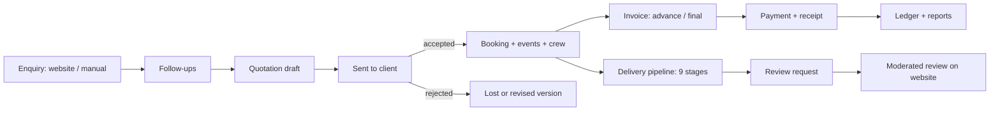
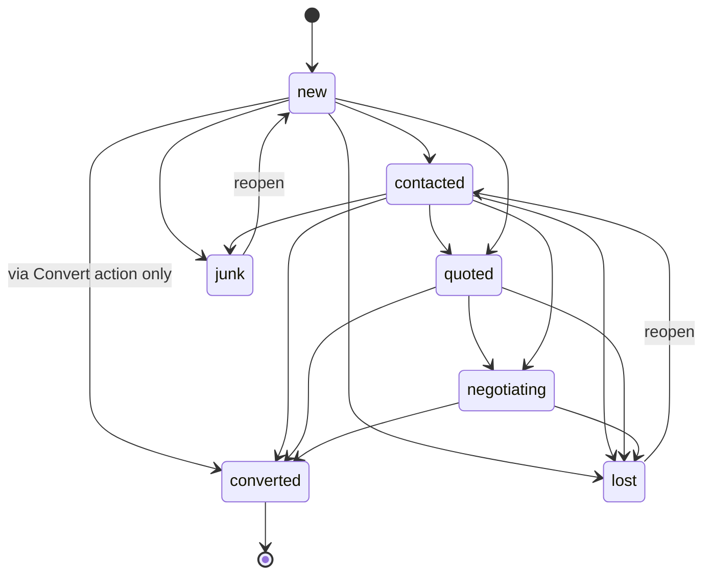
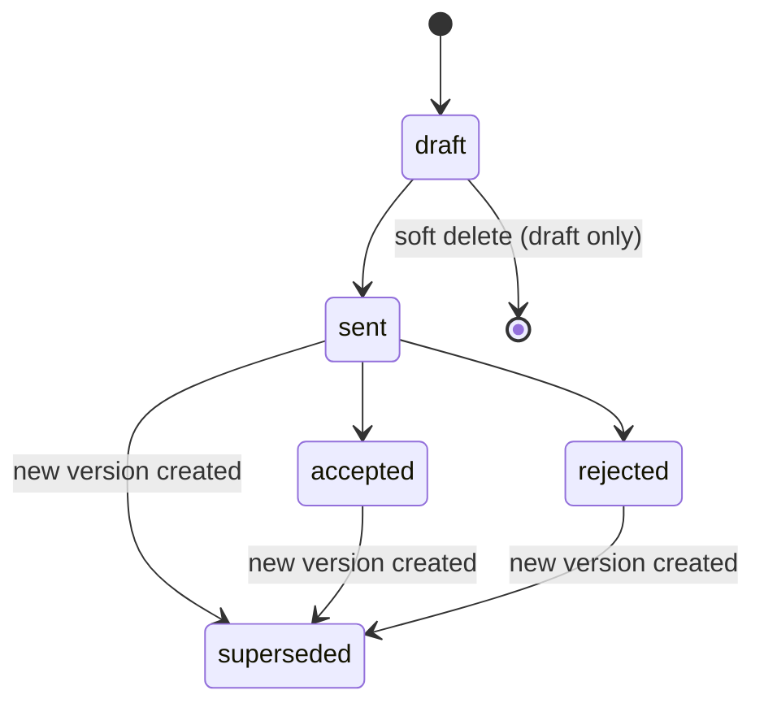
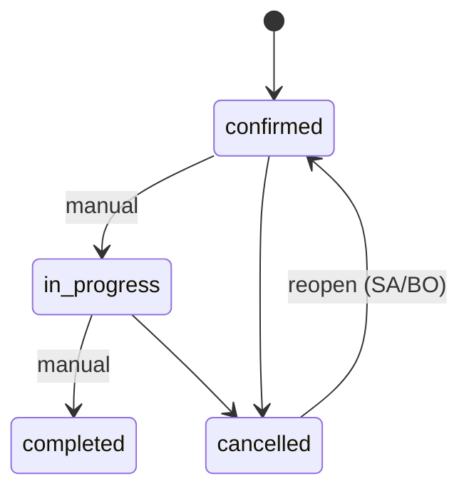
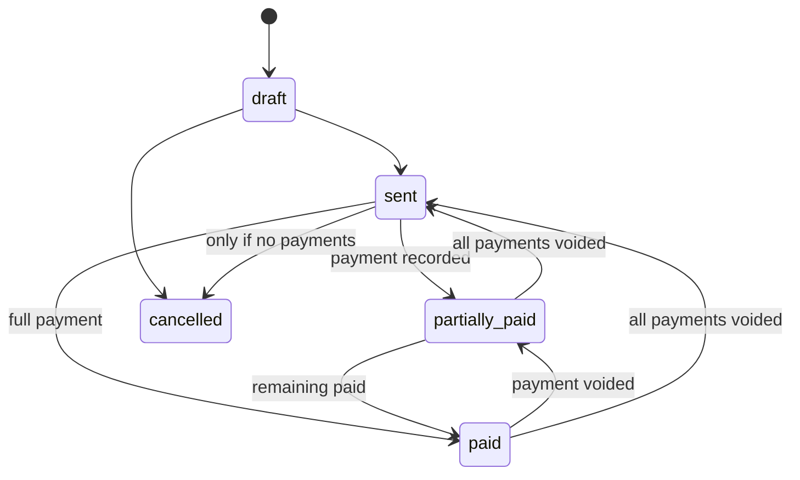
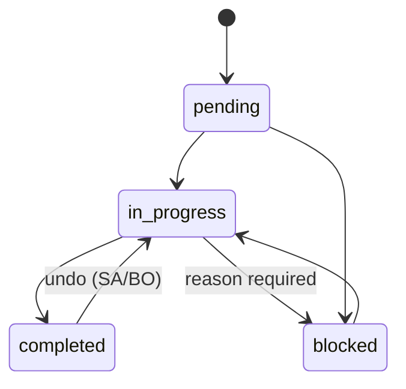

# VOWS Studio — Business Workflows

> **Status:** Draft for review · **Date:** 2026-11-10 · **Depends on:** `DECISION_LOG.md`, `GLOSSARY_AND_ENUMS.md`, `RBAC_PERMISSIONS.md`, `DATABASE_SCHEMA.md`
> **Purpose:** Define every state machine, transition guard, actor, side effect and exception so the build and the tests have one specification. Roles use the abbreviations SA, BO, MG, AC, ST, CR. "Writes activity" means an entry in `activities`; "audits" means `audit_log` is written by the trigger.

---

## 1. Lead-to-cash overview

---

## 2. State machines

### 2.1 Enquiry (`enquiry_status`)

| Rule | Detail |
|---|---|
| Actors | SA, BO, MG. All transitions are **explicit user actions** (CLI-07). Sending a quotation shows a prompt "Mark enquiry as Quoted?" but never changes status silently. |
| `converted` | Only reachable through "Convert to booking" (§3.4). Terminal. |
| `lost` | Requires a reason. `junk` needs none. Reopen allowed for SA, BO, MG. |
| Side effects | Every change writes activity `enquiry_status_changed`. Public submissions start `new`, `created_by` null, source `website`. Creates a notification for BO and MG. |

### 2.2 Quotation (`quotation_status`, plus derived `expired`)

| Rule | Detail |
|---|---|
| Actors | SA, BO, MG create, edit, send, accept, reject. AC view only. |
| Numbering | Number assigned at creation of version 1 and reused by later versions (D-19, D-20). |
| Draft | Editable in place. Soft-deletable. |
| Editing a `sent`/`accepted`/`rejected` quotation | UI asks "Create new version?". On confirm, `create_quotation_version` copies items, sets the old row `superseded`/`is_current=false`, and opens the new `draft`. |
| Expired | Derived: `sent` and `valid_until < today (IST)`. An expired quotation **cannot be accepted** until a new version with a later date is created. |
| Send | Via Gmail (preview modal, §5.1) or "Mark as sent" manually. Sets `sent_at`, requires a generated PDF no older than the last edit. |
| Accept | Manual action. Sets `accepted_at`. Offers "Create booking". Accepted quotation is read-only. |
| After booking exists | A new version may still be created but shows a warning and does **not** change the booking. |
| Side effects | Activity on send/accept/reject. Notification to creator on accept. |

### 2.3 Booking (`booking_status`)

| Rule | Detail |
|---|---|
| Actors | Create and update: SA, BO, MG. Cancel: SA, BO, MG. Reopen and delete: SA, BO. |
| No automation | Event dates passing does not change status (BK-NFR edge case). A prompt appears on the dashboard "Mark completed?" after the last event date. |
| Complete | Allowed any time by BO or MG, with a warning if any non-cancelled invoice has a balance, or the delivery pipeline is not at `completed`. |
| Cancel | Requires reason, optional cancellation fee. **Invoices are untouched** (D-35). Cancelled badge appears on all linked screens. A cancellation fee may be invoiced as a normal invoice line. Delivery pipeline is frozen (read-only). |
| Delete | Soft delete only while `confirmed` and no invoice exists. |
| Creation | Via conversion (§3.4) or standalone. At least one event required. Pipeline with 9 stages created automatically. |

### 2.4 Invoice (`invoice_status`, derived `overdue`)

| Rule | Detail |
|---|---|
| Actors | SA, BO, AC create, edit, send, cancel. MG read only. |
| Draft | Fully editable. Does not appear in financial reports (INV edge case). |
| After `sent` | Only notes, due date and PDF can change. To change amounts: cancel and reissue if no payment exists; otherwise credit note (§3.7). |
| Overdue | Derived: `sent` or `partially_paid` with `due_date < today (IST)` and balance > 0. Highlighted in lists, counted on the dashboard. Never stored. |
| Paid | Locked completely. |
| Status updates | Only by `record_payment`, `void_payment`, `issue_credit_note`, `cancel_invoice` functions. Never by a plain UPDATE from the app. |
| Cancel | `paid_paise` must be 0. Number stays. Reason required. |

### 2.5 Payment (`payment_status`) and receipts

`recorded → voided` (terminal). Actors SA, BO, AC. Void requires a reason, reverses allocations, recomputes invoice status, and removes the income from the ledger automatically (the ledger is a view). The receipt remains but is marked void in the UI and PDF reissue shows a "VOID" stamp.

### 2.6 Credit note (`credit_note_status`)

`issued → cancelled`. Issuing reduces the invoice's effective balance. Cancelling restores it (only if no later action depends on it).

### 2.7 Delivery stage (`delivery_stage_status`)

| Rule | Detail |
|---|---|
| Order | Stage n can be completed only if stage n−1 is `completed` (DEL-03). SA and BO may override with a logged reason. |
| Actors | SA, BO, MG update any stage. ST updates only stages they are assigned to. CR view only. |
| Blocked | Needs a reason. Creates a dashboard alert and a notification to BO and MG. |
| Stage 4 Client Preview | Attach the preview link. Optionally enable the share page (§3.9). |
| Stage 9 Completed | Completing it sets `pipeline.completed_at`, writes activity, and prompts "Send review request?". It does **not** change booking status. |
| Behind schedule | Derived: pipeline target date passed and not completed. Appears on the dashboard. |
| Cancelled booking | Pipeline read-only. |

### 2.8 Review (`review_status`)

`pending → approved | rejected`; `approved → pending` (re-hide, REV-07); `rejected → pending` (reconsider). Actors SA, BO. Each moderation change audits. Only `approved` appears publicly. The aggregate rating is computed from approved rows.

### 2.9 Other small machines

| Object | States and rules |
|---|---|
| Follow-up | `open → done`. Overdue derived (`due_at < now`). Assigned user notified when due. |
| Crew pay record | `unpaid → partially_paid → paid`, derived from sum of `crew_pay_payments`. Over-payment blocked. |
| Invitation | Derived: `pending` (not accepted/revoked, not expired), `accepted`, `expired`, `revoked`. Resend creates a new token and revokes the old one. |
| Review request link | Active until submitted, revoked or 30 days. New link revokes the previous active one. |
| Gmail connection | `disconnected → connected → needs_reconnect → connected`. Refresh failure moves to `needs_reconnect` and raises a banner for SA and BO. |

---

## 3. Process workflows

### 3.1 Public enquiry intake
1. Visitor completes `/contact` (name, phone, email, event type, date, message, source). Honeypot and Turnstile verified.
2. Rate limit applied (60/min/IP). Route Handler validates with Zod and inserts an `enquiries` row (no client) using the service role.
3. Confirmation page `/contact/thank-you`. Notification to BO and MG.
4. Staff open the enquiry, then either **Link existing client** or **Create client** (duplicate check on phone and email, CLI-03, warning not a block).

### 3.2 Follow-up handling
Add follow-up (date, note, assignee) on an enquiry. Daily job at 09:00 IST notifies assignees of items due today and lists overdue items on the dashboard. Marking done writes activity.

### 3.3 Building and sending a quotation
1. From an enquiry or client, **New quotation**. Optionally apply a template.
2. Add lines from the catalogue (current price copied) or manually. Package lines use the **package price**, not the sum of its services.
3. Choose discount type (percent or fixed), valid-until date (default from settings), notes and terms.
4. Totals recomputed on the server at each save (D-16, D-17).
5. Generate PDF. Review. **Send**: preview modal shows subject, body, attachment; confirm; email goes via the connected Gmail with an idempotency key; send log, activity, `sent_at` written.
6. If Gmail is not connected, the button becomes **Download PDF** plus a reconnect link.

### 3.4 Accepting a quotation and creating a booking
1. Mark quotation **Accepted**. Click **Create booking**.
2. A confirmation step shows client, total and the quotation version.
3. `convert_enquiry_to_booking` (or `create_booking_from_quotation` when no enquiry) runs in one transaction: booking number, copied lines, events (the user adds at least one), delivery pipeline with 9 stages, enquiry set to `converted`, activity.
4. Booking page opens with next steps: add crew, create advance invoice.

### 3.5 Events and crew assignment
1. Add events (type, name, date, times, venue, requirements).
2. **Assign crew**: server checks overlapping assignments and unavailability. If conflicts exist, the dialog lists them and requires an override reason. SA, BO, MG may override; it is stored on the assignment and audited (D-34).
3. Saving an event with no crew shows a warning, not a block (BK-04). Crew confirm status is recorded by a manager (`confirmed_at`).
4. Crew users see the event in `/crm/schedule`. No client contact details are shown.

### 3.6 Invoicing and payments
1. **Create invoice** from the booking. Lines prefill from the booking's copied lines and can be edited. For staged billing, create an advance invoice first with a custom line (for example "Advance 40%").
2. Send as in §3.3 (document type `invoice`).
3. **Record payment** (SA, BO, AC): amount, date, method, reference; select invoice(s) to allocate. The amount must equal the sum of allocations. `record_payment` locks invoices, rejects over-allocation, updates statuses, issues a receipt number, writes activity.
4. Receipt PDF is generated and can be sent. One receipt per payment.
5. **Over-payment is rejected** with guidance: create an advance invoice first (D-21).
6. **Void payment** (reason required) reverses everything, including the ledger income.

### 3.7 Correcting an invoice that has payments
1. Issue a **credit note** (SA, BO, AC) for the amount to reduce. In V1 it may not exceed the unpaid balance.
2. If money was already received against the wrong invoice: issue the corrected invoice, then **Reallocate payment** moves the active allocation from the old invoice to the new one in a single transaction. The payment and its receipt stay as they are.
3. Returning money to a client (refund) is **out of scope for V1**. The studio records it as an expense with a note, and a Refund feature is a post-MVP item.

### 3.8 Booking cancellation
Reason and optional fee required. Linked invoices remain and are handled with normal workflows (cancel unpaid ones, credit note or keep paid ones). A cancellation-fee invoice may be created. Crew assignments are kept for history but excluded from availability calculations.

### 3.9 Delivery and client share
1. Pipeline stages are worked in order (§2.7). Attach external links (for example Drive) and short notes.
2. **Share with client** (SA, BO, MG, ST assigned) generates a token page `/delivery/[token]` listing links, revocable and expiring (default 30 days). No login.
3. Client feedback is captured in stage notes by staff. A client-comment form is post-MVP.

### 3.10 Reviews
1. At stage 9 (or any time) a user with `reviews:request` generates a link (30 days) and sends it via Gmail or copies it.
2. Client submits `/review/[token]` (overall and three category ratings, testimonial, display name). One submission per booking.
3. Status `pending`. Notification to BO and SA. Moderator approves or rejects with an optional note.
4. Approved reviews appear on `/reviews` and in JSON-LD. Re-hide returns it to `pending`.

### 3.11 Crew payments
1. Create a pay record for a crew member against a booking or event with an agreed amount (defaults to rate).
2. Record payments (SA, BO, AC). The function inserts the crew payment and an `expenses` row (`crew_payment`, `system`) atomically. Ledger shows it as an expense.
3. Over-payment is blocked. Deleting or editing a crew payment is not allowed; a mistaken one is reversed by an adjusting entry (post-MVP) or by SA data correction with audit.

### 3.12 Expenses and manual income
Create with category, amount, vendor, optional receipt upload (`expense-receipts`). Soft delete allowed for SA, BO, AC (excluded from reports, retained in audit). Crew-payment expenses cannot be created or deleted manually.

### 3.13 Users, invitations and MFA
1. SA invites a user (email, name, role). The link is emailed through Gmail if connected, otherwise shown for manual sharing (D-10). Expiry 72 hours.
2. The invitee sets a password (12+ chars with complexity) on `/invite/[token]`.
3. SA and BO are forced through `/mfa/enroll` before any page. Other roles see an optional prompt.
4. Role change or deactivation revokes sessions at once. Last-owner and last-admin protections apply (RBAC §9).
5. Lockout after 5 failed logins in 15 minutes for 30 minutes. SA can unlock.

### 3.14 Gmail connect and change
1. SA or BO opens Settings → Integrations → Gmail, clicks Connect. OAuth with state parameter and scopes `gmail.send`, `openid`, `email`.
2. Tokens are encrypted and stored. The connected address is displayed. A test email can be sent to the user.
3. **Change account:** Disconnect (revoke at Google, delete tokens) then Connect with the new account. Past log entries keep the old sender.
4. If refresh fails (token revoked, unused for about six months, or the Google account password was changed): status `needs_reconnect`, banner for SA and BO, send buttons fall back to PDF download. The app also tracks a soft daily send budget (400) against Gmail's roughly 500 recipients per day cap and warns near it.

### 3.15 GST toggle
Enabling or disabling GST is by SA or BO, audited (`gst_toggle`). It affects **new** documents only. Existing documents keep their stored tax snapshot. When enabled, clients need a state (and GSTIN for B2B) and services need HSN/SAC codes, otherwise document creation shows a clear blocking message.

### 3.16 Financial year rollover
On the first document created on or after 1 April IST, the new FY sequence starts at 000001 automatically. Reports and dashboard financial-year filters use April–March. Nothing needs manual action.

### 3.17 Backdated entries (D-04)
Issue dates may be earlier than creation, flagged "Backdated" in the UI and audit. Numbers still follow creation order.

### 3.18 Setup mode, data reset and go-live lock (D-43)
1. A fresh install starts in **setup mode**. `/admin/system/data` shows a checklist (studio profile, branding, Gmail, catalogue, crew, first client) and the current mode.
2. **Load sample data** (optional) fills the system with the synthetic Lumina dataset so the owner can explore every screen.
3. **Reset wizard** (SA only): choose scopes and options, run a **dry run** to see row counts, re-enter password, type `RESET VOWS DATA`. The system exports the affected tables to a zip (stored privately and downloadable), then deletes in one transaction, removes related stored files, and writes a `data_reset` audit entry. Users, settings, templates, categories, Gmail and numbering configuration are untouched. Optional: restart numbering at 000001.
4. The owner then enters real clients, catalogue, crew, bookings, quotations and payments by hand (back-dated entries allowed, §3.17).
5. At go-live SA presses **Lock setup** (typed confirmation). From then on reset is unavailable in production and the UI says so. The demo environment keeps reset enabled permanently and runs it weekly.
6. A failed export aborts the reset with nothing deleted. A reset in progress blocks other writes by the same function lock; other users see a maintenance message.

---

## 4. Automated jobs (Vercel Cron, Pro plan)

| Job | Schedule (IST) | Action |
|---|---|---|
| Daily digest | 09:00 | Notify assignees of follow-ups due and overdue; notify BO and AC of newly overdue invoices. |
| Expiry sweep | 02:00 | Mark expired invitation, review link and delivery share tokens as inactive (derived rules are authoritative; this only cleans data). |
| Quotation expiry reminder | 09:00 | Notify creator of quotations expiring within 3 days. |
| Demo reset | Sunday 02:00 UTC | Demo project only (D-32). |

---

## 5. Cross-cutting behaviours

### 5.1 Document sending (quotation, invoice, receipt, credit note, review link)
Preview modal → confirm → idempotency key → generate or reuse a fresh PDF → send via Gmail API with retry on 429/5xx → write `email_send_log` and activity → toast. Failures are logged to `generation_errors`, shown to the user, and never silently dropped (GMAIL-08).

### 5.2 Notifications

| Trigger | Recipients |
|---|---|
| New public enquiry | BO, MG |
| Quotation accepted | Creator, BO |
| Stage blocked | BO, MG |
| New review submitted | BO, SA |
| Follow-up due or overdue | Assignee |
| Invoice newly overdue | BO, AC |
| Gmail needs reconnect | BO, SA |
| Account locked | SA |

### 5.3 Derived status rules (single definitions)
`expired` quotation, `overdue` invoice, `behind_schedule` pipeline, `overdue` follow-up are computed in SQL views or helper functions and reused by lists, dashboards and exports so they never disagree.

### 5.4 Error and exception handling

| Situation | Behaviour |
|---|---|
| Client total differs from server total | Reject with `UNPROCESSABLE`, show recalculated totals. |
| Concurrent payment on same invoice | Second request waits on the row lock, then fails with a clear balance message if no longer valid. |
| Crew conflict | Warning dialog with override path (SA, BO, MG only). |
| Session expired while editing | Redirect to login, restore unsaved form data from `sessionStorage` where feasible (AUTH-10). |
| PDF generation fails | Message with retry. Stored `pdf_path` is not updated. |
| Gmail failure | Specific guidance (reconnect, invalid recipient, quota). |
| Soft-deleted parent | Child records remain readable in history but cannot be edited. |

---

## 6. Permission summary per transition

| Transition | Who |
|---|---|
| Enquiry status changes | SA, BO, MG |
| Quotation send, accept, reject | SA, BO, MG |
| Booking cancel | SA, BO, MG |
| Booking reopen and (soft) delete | SA, BO |
| Invoice create, send, cancel | SA, BO, AC |
| Record, void, reallocate payment | SA, BO, AC |
| Credit note issue | SA, BO, AC |
| Delivery stage update | SA, BO, MG; ST if assigned |
| Stage skip or undo | SA, BO |
| Review request | SA, BO, MG |
| Review moderation | SA, BO |
| Crew pay and payments | SA, BO, AC |
| Gmail connect, GST toggle | SA, BO |
| User and role management | SA |

---

## 7. Open items deliberately left out of V1

Refunds, client portal, client comments on delivery, tentative bookings, quotation open tracking (`viewed`), fractional quantities, crew payment adjustments, WhatsApp and SMS notifications, online payments (Razorpay).
