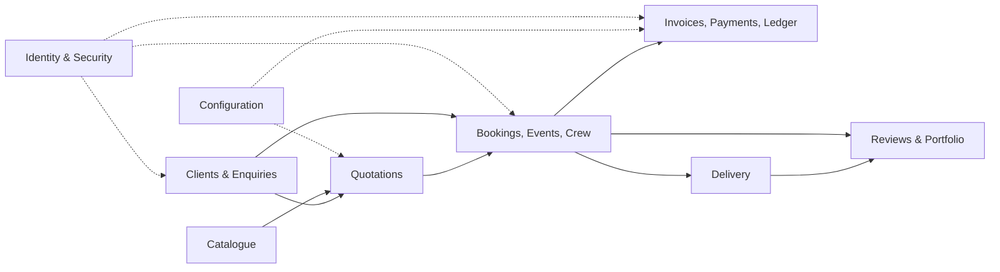
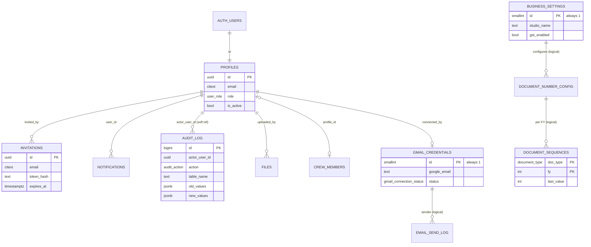
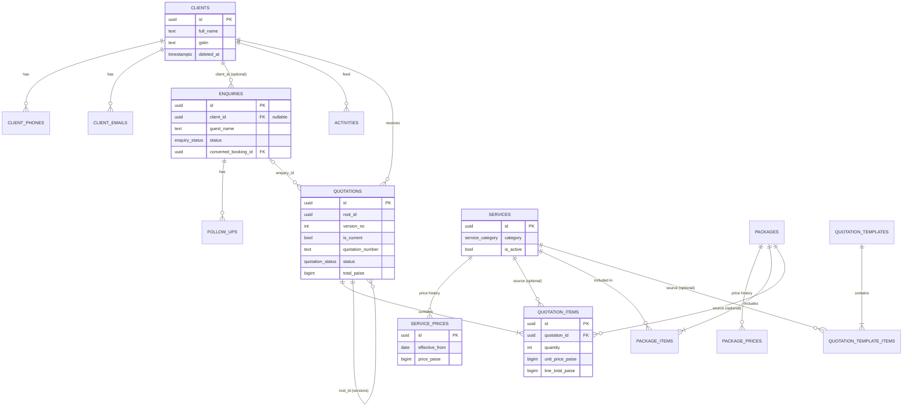
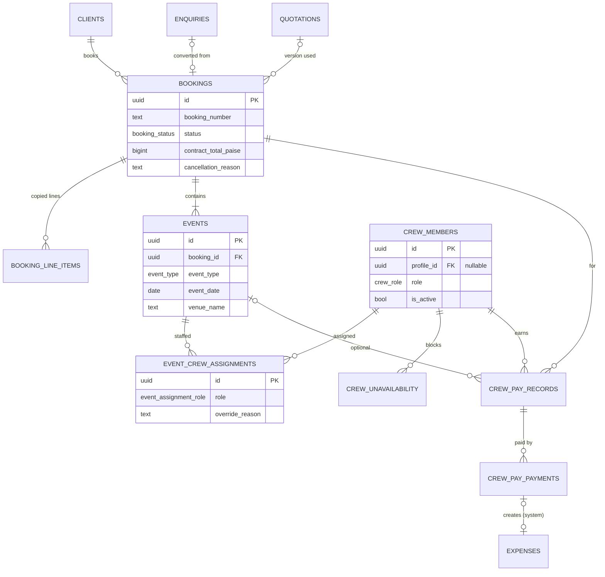
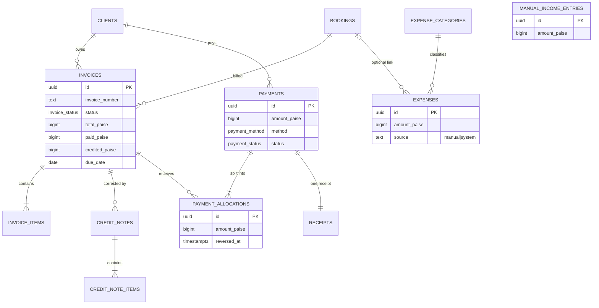
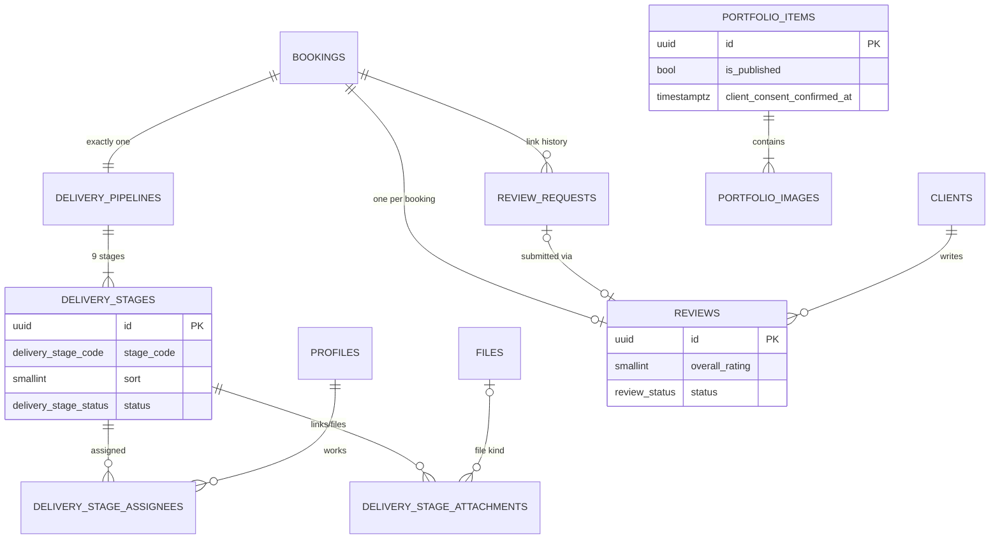

# VOWS Studio — Database ERD

> **Status:** Draft for review · **Date:** 2026-11-10 · **Source of truth:** `DATABASE_SCHEMA.md`. If a diagram and the schema disagree, the schema wins and this file is corrected.
> Diagrams use Mermaid `erDiagram`. Only keys and the most important columns are shown. Cardinality notation: `||` exactly one, `o|` zero or one, `|{` one or more, `o{` zero or more.

---

## 1. Overview (domain map)

Solid arrows are data dependencies (foreign keys). Dotted arrows are configuration or audit/identity references.

---

## 2. Identity, security and configuration

Standalone tables (no FK): `email_templates`, `expense_categories`, `site_content`, `site_page_seo`, `faq_items`, `service_category_tax`, `generation_errors`, `auth_attempts`.

---

## 3. Clients, enquiries, catalogue and quotations

---

## 4. Bookings, events and crew

---

## 5. Billing, payments and ledger

**Ledger (view, not a table):** `ledger_entries_v` = non-voided `PAYMENTS` (income) ∪ `MANUAL_INCOME_ENTRIES` (income) ∪ non-deleted `EXPENSES` (expense). No foreign keys because it is derived.

---

## 6. Delivery, reviews and portfolio

---

## 7. Relationship rules (cardinality and delete behaviour)

| Relationship | Rule |
|---|---|
| client → enquiries | Optional. Guest enquiries have no client. Client delete is soft. |
| quotation versions | All versions share `root_id` and `quotation_number`. Exactly one row per root has `is_current = true`. |
| enquiry → booking | At most one booking per enquiry (`converted_booking_id`). |
| booking → events | One or more. Booking cannot be created without at least one event. |
| booking → delivery pipeline | Exactly one, created with the booking, with 9 stages. |
| booking → invoices | Zero or many (advance and final invoices). |
| payment → allocations | One or many. Active allocations must sum to the payment amount (deferred constraint). |
| payment → receipt | Exactly one, created with the payment. |
| invoice → credit notes | Zero or many. Credited amount plus paid amount cannot exceed total. |
| crew pay payment → expense | One system expense per crew payment, created in the same transaction. |
| booking → review | At most one review per booking. Many review request links allowed over time. |
| Financial tables | `ON DELETE RESTRICT` throughout. No row in a financial table is ever deleted. |
| Child item tables | `ON DELETE CASCADE` only for quotation, booking, template, portfolio and delivery children, because their parents are soft-deleted and never physically removed in normal operation. |

---

## 8. Table count and ownership by migration

| Domain | Tables |
|---|---|
| Identity & security (7) | `profiles`, `invitations`, `auth_attempts`, `audit_log`, `notifications`, `files`, `generation_errors` |
| Configuration (11) | `business_settings`, `document_number_config`, `document_sequences`, `service_category_tax`, `email_templates`, `gmail_credentials`, `email_send_log`, `expense_categories`, `site_content`, `site_page_seo`, `faq_items` |
| CRM (6) | `clients`, `client_phones`, `client_emails`, `enquiries`, `follow_ups`, `activities` |
| Catalogue (5) | `services`, `service_prices`, `packages`, `package_prices`, `package_items` |
| Quotations (4) | `quotations`, `quotation_items`, `quotation_templates`, `quotation_template_items` |
| Bookings & crew (8) | `bookings`, `booking_line_items`, `events`, `crew_members`, `event_crew_assignments`, `crew_unavailability`, `crew_pay_records`, `crew_pay_payments` |
| Billing & finance (9) | `invoices`, `invoice_items`, `credit_notes`, `credit_note_items`, `payments`, `payment_allocations`, `receipts`, `expenses`, `manual_income_entries` |
| Delivery (5) | `delivery_pipelines`, `delivery_stages`, `delivery_stage_assignees`, `delivery_stage_attachments`, `review_requests` |
| Reviews & portfolio (3) | `reviews`, `portfolio_items`, `portfolio_images` |

Total: 58 tables, plus 9 views (listed in `DATABASE_SCHEMA.md` §11).
